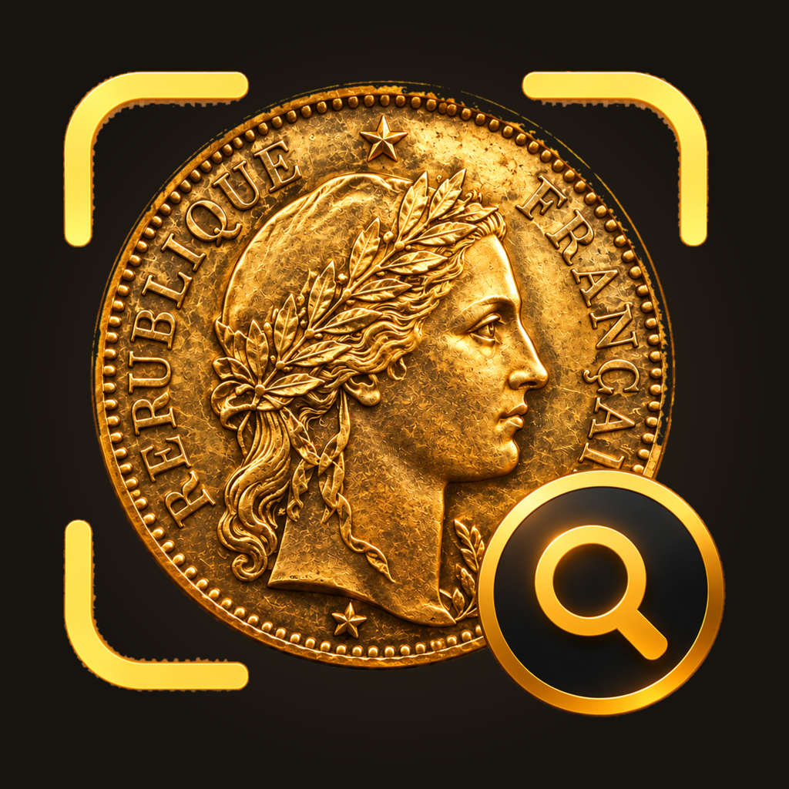
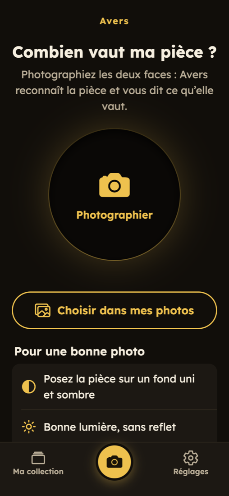
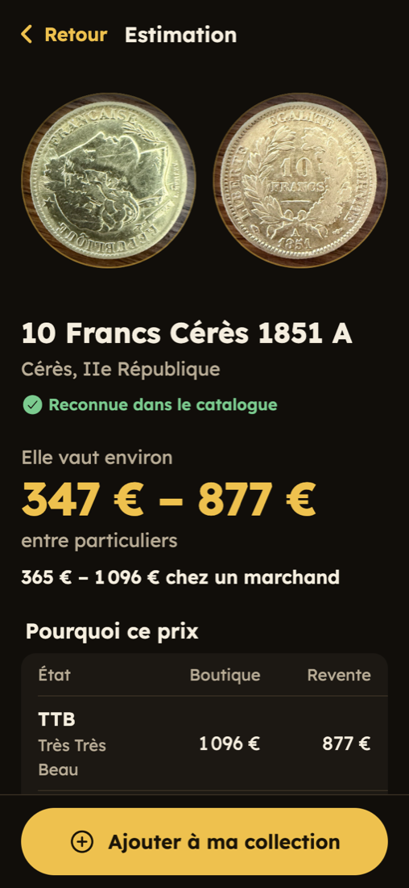
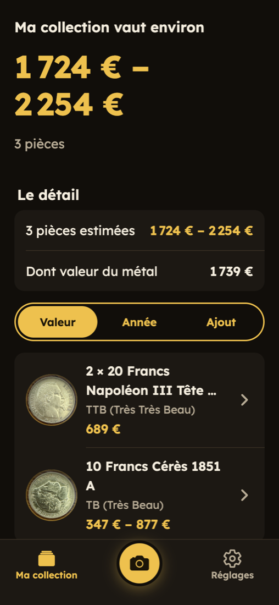

<p align="center"></p>

# Avers

**Take a photo of a coin, find out what it is and what it's worth.**

<p align="center">
  
  
  
</p>

Avers is a small mobile app for coin collectors. You photograph a coin from both sides and it:

- **identifies** the coin (country, year, mint, denomination, type, catalog references) with a vision model, then
  finds it in the catalog, which is the source of truth for its facts and prices,
- **estimates its condition** on the French grading scale (B · TB · TTB · SUP · SPL · FDC),
- **values it** from the catalog listings of that exact coin, per grade, with shop and private-resale prices
  (Numista's indicative price when the catalog has none; never a made-up one),
- **asks** which year the coin shows when the date read may be wrong (a worn 5 taken for a 6),
- computes the **melt value** of its precious metal content from live spot prices,
- keeps a **personal collection** with quantities, notes and a running total value.

French UI with large text and big touch targets. Runs on iOS and Android.

## Architecture

```
mobile/   Expo (React Native) app: camera → estimate → collection
backend/  FastAPI service: vision identification, catalog matching, valuation, spot prices, collection storage
data/     local only (git-ignored): catalog database, images, collection, uploaded photos
```

```
phone ──photos──▶ POST /estimate
                   ├─ vision model: read the photos (or refuse: not a coin / unidentifiable)   ← the only AI call
                   ├─ matching (plain rules): catalog listings with the same country, value, year, mint,
                   │    reference — confirmed by visual similarity (local DINOv2 over catalog photos)
                   └─ pricing (plain code): price per grade from those listings, old prices brought to
                        today's metal price, never below melt; no listing → no price, never a guess
       ◀─result─┘
phone ──save──▶ POST /collection  (separate SQLite file, never touched by catalog imports)
```

- **Multi-source catalog**: every listing carries a `source`, so other dealers and countries can be added next to the first one.
- **Multi-currency**: catalog prices and melt values are converted to the currency chosen in the app (EUR, CHF, USD, GBP, CAD).

## Running it

### API

Requires [uv](https://docs.astral.sh/uv/) and a [Vercel AI Gateway](https://vercel.com/docs/ai-gateway) key in `AI_GATEWAY_API_KEY`
(see `backend/.env.example`). The model is a setting (`VISION_MODEL`, default `google/gemini-3.5-flash-lite`,
with `google/gemini-3.8-flash` as fallback), chosen with the benchmark below.

```bash
cd backend
uv run --extra vision python -m app.visual build         # once, after importing catalog images (torch + DINOv2)
uv run --extra vision python -m app.visual export        # once: the ONNX model the API serves with
uv run uvicorn app.main:app --host 0.0.0.0 --port 8000
```

Serving needs only onnxruntime; without the exported model the API still works, it just skips the visual
look-alike check. The collection is a local SQLite file, or Postgres when `DATABASE_URL` is set.

The catalog lives in `data/coins.sqlite` (schema in `backend/app/db.py`). It is populated by import tooling that is not part of this repository. Without it the app still identifies coins and computes melt values. It just has no comparables to show.

### App

```bash
cd mobile
cp .env.example .env.local   # set EXPO_PUBLIC_API_URL to your computer's LAN IP
npm install --legacy-peer-deps
npx expo start
```

Scan the QR code with Expo Go on the phone (same Wi-Fi as the API). Expo Go requires the same free Expo account to be
signed in on the phone and in the CLI (`npx expo login`). In development the app talks to the computer serving the
bundle on port 8000 (start the API with `--host 0.0.0.0`); the address can be changed under **Réglages**, or passed
in the link: `exp://…/--/?api=<url>&lang=fr` (development builds only).

Styling is [NativeWind](https://www.nativewind.dev) (Tailwind classes). Design tokens (the "noir & or" palette,
Lexend type ramp, spacing, radius) live in `mobile/src/theme/tokens.js` and feed both `tailwind.config.js` and
`src/theme`; shared primitives are in `src/components/ui.tsx`. Format with `npx prettier --write src`.

### Hosting (Vercel)

- **API** (`backend/`, Vercel project `avers-api`): FastAPI on Vercel Functions (Python, Frankfurt region next to the database). The catalog
  ships read-only inside the function, the collection and its photos live in Postgres (Neon, from the Vercel
  Marketplace). `backend/deploy.sh` copies the catalog and the ONNX model into the bundle and deploys; both stay out
  of git. Environment: `AI_GATEWAY_API_KEY`, `APP_TOKEN`, `DATABASE_URL`, `CORS_ORIGINS`, `MAX_ESTIMATES_PER_DAY` (default 100), `COINS_DB=.deploy/catalog.sqlite`,
  `COINS_DB_READONLY=1`, `VISION_ONNX=.deploy/dinov2-small.onnx`, optional `NUMISTA_API_KEY`.
- **Numista** (optional, free API plan): when the catalog has no listing of a coin, `app/numista.py` looks its type
  up (by Gadoury number) for the years and mints really struck, the mintage and an indicative price per grade.
  Answers are cached in the database; `NUMISTA_MAX_PER_MONTH` (default 1800) keeps it under the free quota.
- **Web app** (`mobile/`, Vercel project `avers`): the Expo web export, installable from Safari ("Add to Home Screen").

## Development

```bash
cd backend && uv run pytest && uv run ruff check app tests bench && uv run ruff format app tests bench
cd mobile && npx tsc --noEmit && npx expo-doctor
```

CI runs both on every push and pull request.

### End-to-end tests (iOS Simulator)

[Maestro](https://maestro.dev) flows in `mobile/.maestro/` drive the app in Expo Go: a smoke test, the language
switch, a full journey (front and back photos → real estimate → copy → save → collection total → delete) and a
non-coin photo that must be refused.

```bash
brew install mobile-dev-inc/tap/maestro          # needs a JDK (e.g. openjdk@21)
# `npx expo start` running; fixture photos in mobile/.maestro/fixtures/: coin-front.jpg, coin-back.jpg, not-coin.jpg
mobile/scripts/e2e-ios.sh                        # all flows; or pass a flow file
```

The script starts its own API on port 8001 with an empty, throwaway collection, so tests never touch real data, and
opens the app with that server in the link. The full journey makes real vision-model calls; the test API turns the
1851 it reads into 1861 (`E2E_MISREAD_YEARS`) so the flow also answers the year question.

### Choosing the vision model

`backend/bench/models.py` runs the production call against any gateway models on catalog coins of known identity,
real phone photos (in order and swapped) and traps (blur, glass, medals, banknotes). It reports how often the reading
selects the right catalog listing, plus cost and latency:

```bash
cd backend && AI_GATEWAY_API_KEY=... uv run python -m bench.models google/gemini-3.5-flash-lite anthropic/claude-sonnet-5.5
```

## Disclaimer

Estimates are indicative only: they combine dealer asking prices, an AI-estimated grade and the metal price of the day. Have valuable coins appraised by a professional before selling.

## License

[MIT](LICENSE)
